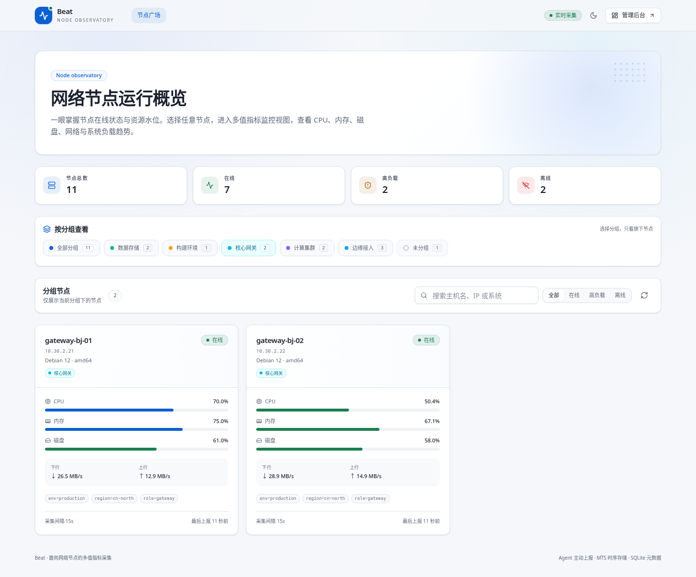
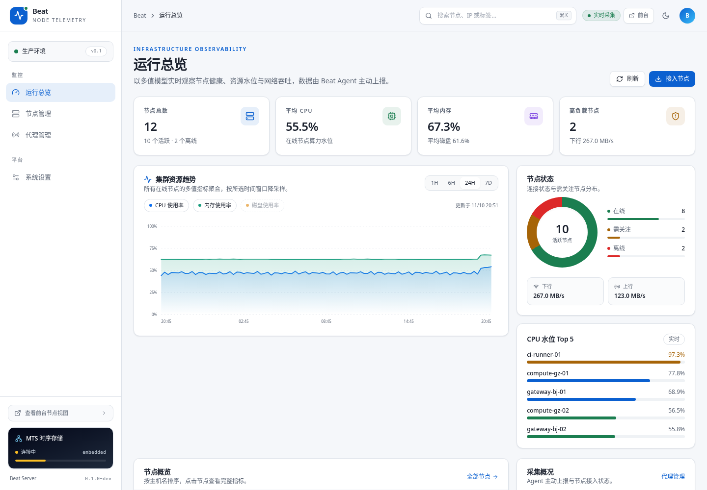
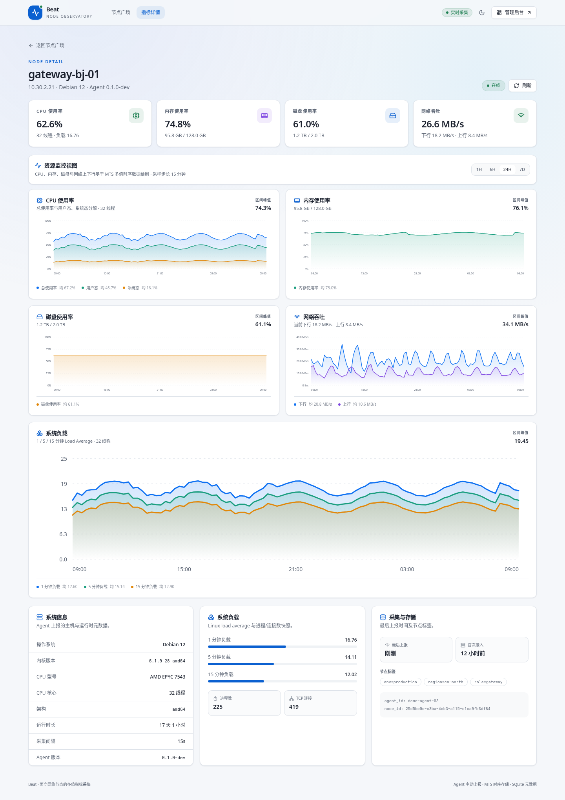
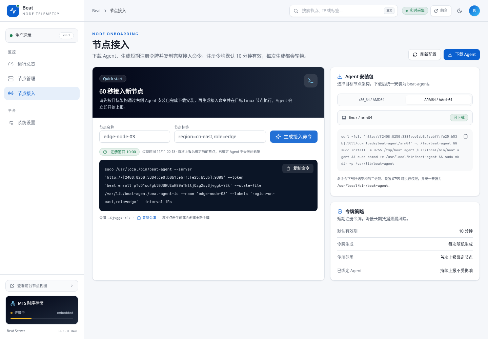
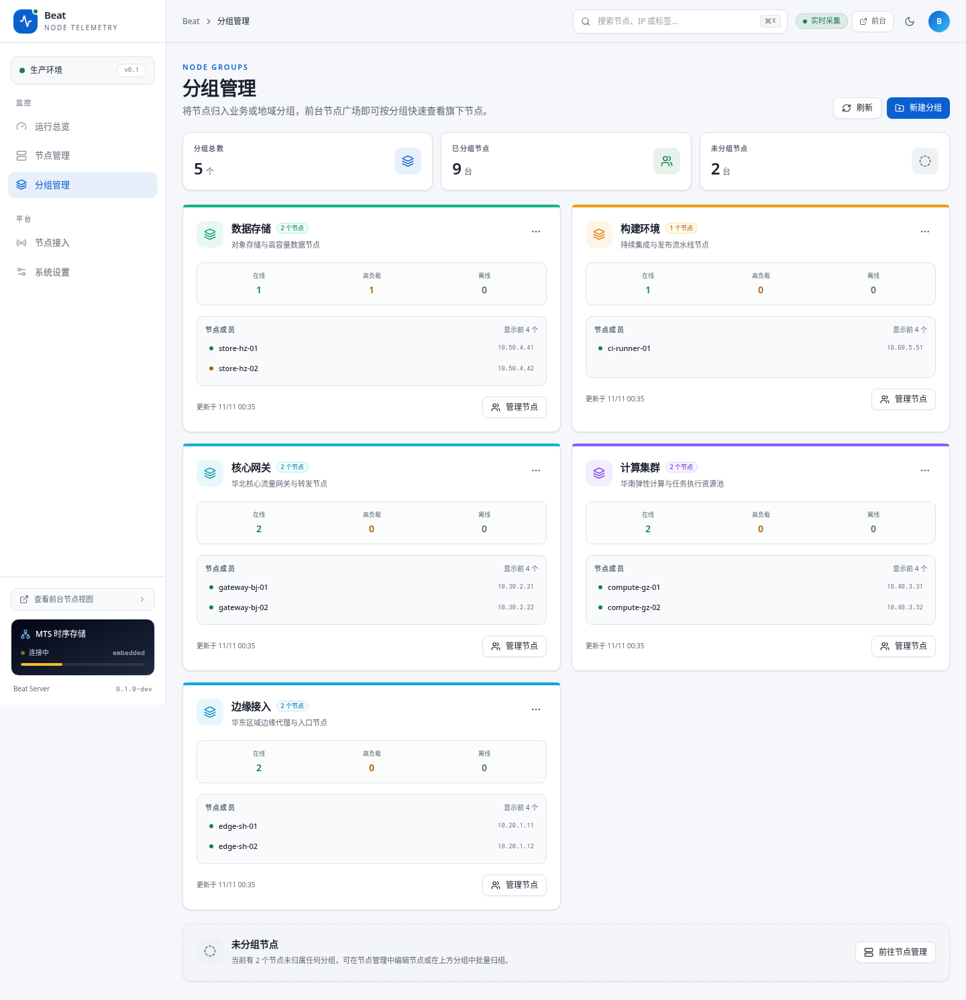
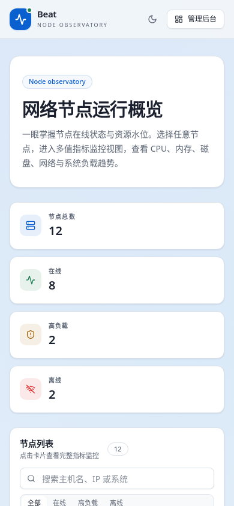
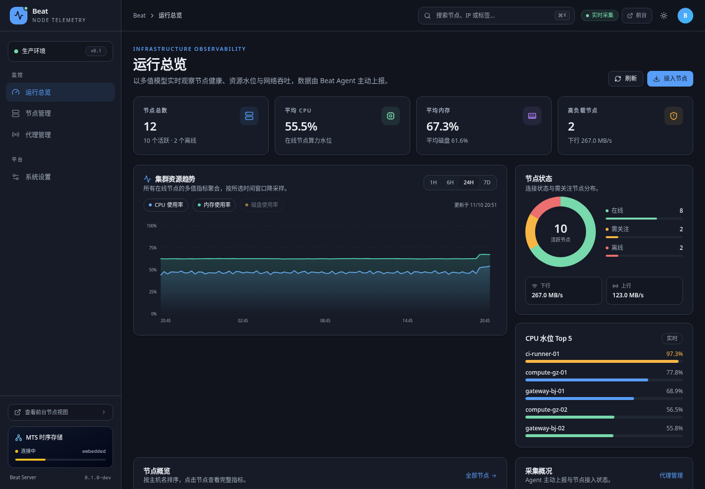

# Beat

Beat 是一个面向网络节点的轻量级指标采集与可观测平台。它由 **Beat Server**、**Beat Agent** 和 **React 控制台**组成，使用多值模型时序引擎 [`github.com/openmts/mts`](https://github.com/openmts/mts) 存储节点指标，使用 SQLite 存储节点、分组、代理和系统设置等关系型数据。



与 Prometheus + Grafana 组合相比，Beat 的设计目标不是通用监控平台，而是：

- **多值模型**：一个时间点同时写入 CPU、内存、磁盘、网络、负载等多个字段，减少 series 数量与查询拼接成本。
- **双向 gRPC 长连接**：Agent 主动连接 Server，复用一条 HTTP/2 双向流完成指标上报、任务下发、进度回执与卸载控制，不要求被监控节点开放入站端口。
- **单二进制交付**：Go 服务端内嵌 React SPA，运行时无需额外组件。
- **前后台分离**：前台面向日常巡检，以节点分组卡片和指标详情为主；后台负责节点管理、分组管理、节点接入和运行总览，不引入完整 Grafana。

## 核心能力

- Agent 采集 CPU、内存、Swap、磁盘、网络、Load Average、进程数、TCP 连接数、运行时长和网卡信息；网卡明细仅用于服务端内部存储，不会通过节点查询 API 返回。
- Agent 使用令牌认证，通过 gRPC 双向流连接到 Server；节点首次上报自动注册。
- Server 将多值指标写入 MTS，将节点/代理/设置写入 SQLite。
- 前台提供节点状态卡片广场，点击节点可查看 CPU、内存、磁盘、网络上下行与 1/5/15 分钟系统负载五类独立监控视图，以及主机信息。
- 前台采用受控主题文档与 Block 渲染；后台 **前台主题** 提供 Beat 内置主题库，用户只需选择主题、预览首页与节点详情，再一键应用。当前内置「极简」与「Beat 默认主题」两套完整主题。
- 前台只读取 `/api/v1/public/*` 投影接口，公开 DTO 不包含 `agentId`、Agent 版本和网络接口信息；内部节点与分组读取接口统一要求管理员会话。
- 后台提供运行总览、节点管理、分组管理、节点接入、任务中心和系统设置页面；节点支持编辑管理侧名称、标签、所属分组以及卸载 Agent。
- 任务中心支持“三网时延与丢包检测”和自定义 Shell 两种任务模板；三网任务默认通过 TCP Connect 探测电信、联通、移动目标，Server 通过 gRPC 流即时推送并回传结构化结果。
- 前台节点广场保持公开访问；后台采用单管理员账号登录，默认账号与密码均为 `admin`，登录会话使用 HttpOnly Cookie 保存 12 小时。
- 管理员会话持久化在 SQLite，Server 重启不会中断登录；所有写操作要求 CSRF Token 与同源校验，登录失败触发限流，管理操作写入审计日志。
- Agent 安装包提供 SHA-256 校验，下载命令会在安装前验证摘要；Agent 支持 `doctor` 自检命令和可选 HTTPS 证书校验。
- 分组支持创建、编辑、删除和批量调整成员；前台节点广场可按分组筛选旗下节点。
- Demo 模式自动生成最多 12 个节点、5 个节点分组和 24 小时时序数据，便于直接验收界面。

## 快速开始

### 前置条件

- Go `1.26+`
- Node.js `24+` 和 npm

### 构建

```bash
npm --prefix web install
make build
```

产物：

- `bin/beat-server`
- `bin/beat-agent`
- `bin/beat-agent-linux-amd64`
- `bin/beat-agent-linux-arm64`

也可以分别执行 `make web`、`make server`、`make agent` 和 `make test`。`make agent` 会同时生成当前主机使用的 `beat-agent`，以及用于服务端分发的 x86_64 与 ARM64 两个 Linux 二进制。

### 发布与 Nightly 构建

GitHub Actions 提供两套发布流程，产物均包含 Linux `amd64`、`arm64` 的 `beat-server`、`beat-agent` 二进制以及 `checksums.txt`：

- **Release**：推送 `v*` 标签（例如 `v0.1.0`）时触发，构建正式版本并发布到同名 GitHub Release。
- **Nightly**：每次向任意分支推送代码时触发，固定使用 `nightly` 标签滚动更新预发布 Release；产物文件名与正式版本完全一致。

两个流程都写入当前仓库的 GitHub Release，因此仓库需要在 **Settings → Actions → General → Workflow permissions** 中允许 `Read and write permissions`。

### 启动服务

```bash
./bin/beat-server --listen '[::]:9099' --data-dir ./data
```

打开 <http://127.0.0.1:9099> 进入前台节点广场，打开 <http://127.0.0.1:9099/admin> 进入管理后台。首次登录使用账号 `admin`、密码 `admin`，建议登录后立即在 **系统设置 → 账户与安全** 中修改。服务默认监听 IPv6 全地址 `[::]:9099`，在双栈系统上同时接受 IPv4 与 IPv6 连接；Web HTTP/1.1 与 Agent gRPC 复用同一端口。

生产环境建议启用原生 HTTPS（同时保护控制台与 gRPC）：

```bash
./bin/beat-server \
  --listen '[::]:9099' \
  --data-dir /var/lib/beat \
  --tls-cert /etc/beat/tls/server.crt \
  --tls-key /etc/beat/tls/server.key
```

需要演示数据时显式添加 `--demo`。Demo 模式会创建最多 12 个演示节点、5 个分组和 24 小时时序数据；生产环境不要启用。

#### systemd 部署 Server

完成 `make build` 后，以 root 执行：

```bash
sudo ./deploy/install-server.sh
# 等价的内置初始化命令
sudo /usr/local/bin/beat-server install
# 或从构建目录直接安装
sudo ./bin/beat-server install
```

只安装并 enable、暂不启动时使用 `beat-server install --no-start`。如果当前已有手工启动的 `beat-server` 进程，请先停止它，避免与 systemd 服务争用 `9099` 端口。

`beat-server install` 会：

1. 将 `beat-server` 安装到 `/usr/local/bin/beat-server`。
2. 将 amd64/arm64 Agent 安装包安装为 `/usr/local/bin/beat-agent-linux-amd64` 和 `/usr/local/bin/beat-agent-linux-arm64`，供节点接入页面下载和批量升级。
3. 创建 `/var/lib/beat` 与 `/etc/beat`，首次安装时生成 `/etc/beat/server.yaml`；已有配置不会被覆盖。
4. 安装 `/etc/systemd/system/beat-server.service`，执行 `daemon-reload`、`enable` 并启动服务。

`deploy/install-server.sh` 只是上述命令的引导入口，可通过 `BEAT_START_NOW=false` 传递 `--no-start`。

Server 单元以 root 运行，配置集中在 `/etc/beat/server.yaml`。systemd 使用 `--config /etc/beat/server.yaml` 显式加载。常用运维命令：

```bash
sudo systemctl status beat-server
sudo systemctl restart beat-server
sudo journalctl -u beat-server -f
```

### 界面预览

| 前台节点广场 | 后台运行总览 |
|---|---|
|  |  |

| 节点指标详情 | 节点接入 |
|---|---|
|  |  |

| 分组管理 |
|---|
|  |

| 移动端节点视图 | 后台深色主题 |
|---|---|
|  |  |

### 接入真实 Agent

在管理后台的 **节点接入** 页面，先选择目标架构并复制“Agent 一键安装”命令。命令会校验主机架构与 SHA-256，创建 `/etc/beat`，将二进制直接安装为 `/usr/local/bin/beat-agent`，并生成以 root 运行的 `/etc/systemd/system/beat-agent.service`。Agent 首次启动后会在 `/etc/beat/agent-id` 写入权限为 `0600` 的节点身份文件。

随后填写节点名称和标签，点击“生成接入命令”。每次生成都会创建全新随机令牌，默认 10 分钟有效；接入命令将配置写入 `/etc/beat/agent.yaml`（0600），执行 `systemctl enable beat-agent` 和 `systemctl restart beat-agent`，Agent 随后在 systemd 下持续运行。令牌在节点首次上报后绑定该 Agent，已绑定的 Agent 持续上报不受注册窗口关闭影响。

Agent 单元以 root 运行，以便完成受控自更新、systemd 单元更新和本地卸载；它不接受任意下载地址、SSH 凭据或远程 Shell。任务中心的自定义 Shell 任务也会继承 root 权限，因此只应向可信管理员开放。

Agent 启动后建立 `beat.agent.v1.AgentControl/Connect` gRPC 双向流，每 15 秒上报一次指标，同时监听 Server 推送的控制消息。Server 会将超过 `3 × 采集间隔`（最低 45 秒）未上报的节点判定为离线。

### 批量升级 Agent

“节点接入”页面的 **Agent 版本升级** 卡片提供一键升级全部节点。升级完全由 Server 下发的 gRPC 控制消息触发；Agent 不启动 update daemon、不轮询版本，也不会主动检查更新。

升级流程：

1. Server 计算节点版本、架构和目标发布包，创建升级批次。
2. 在线 Agent 立即收到 `AgentUpgrade` 指令；离线 Agent 保持排队，重新连接后继续。
3. Agent 从当前 Beat Server 的固定下载路径获取对应架构二进制，校验大小与 SHA-256。
4. 新二进制通过 `--version` 自检后，在 `/usr/local/bin` 内原子替换旧版本，并保留 `beat-agent.previous`。
5. Agent 退出并由 systemd 自动重启；Server 以同一 `agentId` 上报目标版本作为升级成功依据。

服务端并发限制为 10 个节点同时处于已下发状态。升级期间可在页面查看排队、安装、重启、成功和失败数量；失败节点支持批量重试。Agent 以 root 运行以完成标准安装路径下的原子替换和 systemd 重启，但下载地址必须与当前 Server 同源，不接受 SSH 凭据或任意远程 Shell。

### 节点编辑与卸载

节点管理页的操作列使用三点菜单，展开后提供“编辑节点配置”和“卸载 Agent”。编辑后的名称、标签与所属分组保存在 SQLite，并覆盖后续上报中的同名字段；Agent 本地采集配置不会被修改。

分组管理页支持创建分组、配置识别色、编辑说明、批量选择节点成员和删除分组。一个节点只能归属一个分组；删除分组只会将节点转为未分组，不会删除节点或历史指标。前台节点广场按分组展示节点数量和筛选入口。

卸载确认后，Server 会立即删除节点记录、历史 MTS 指标和注册凭据，同时生成 `uninstall_agent` 任务。在线 Agent 会通过已建立的 gRPC 双向流立即收到任务，无需等待下一轮采集；Agent 离线时任务保持排队，待其重新连接后执行。Agent 完成本地清理后通过同一流回执，包括停止并移除 systemd 服务、删除 `/etc/beat/agent.yaml`、`/etc/beat/agent-id` 与 `/usr/local/bin/beat-agent`。

### 任务中心

任务中心当前只保留管理员按需创建的任务，提供两类模板：

- **三网时延与丢包检测**：分别配置电信、联通、移动目标，默认使用 TCP Connect。每个目标可配置主机/IP、端口、地址族，以及探测次数、间隔和单次超时。
- **自定义 Shell**：支持名称、说明、Shell 脚本、执行周期、超时和启停状态编辑，并可开启“指标编排”。

Shell 任务的指标编排支持自定义 MTS measurement（表名称，默认 `task_metrics`），以及最多 64 个数值字段。每项指标可配置字段键、展示名称、单位，并通过 JSON 路径、Key=Value 或正则捕获从脚本输出提取数值。表名只能使用小写字母、数字和下划线，且不能占用 `node_metrics`、`network_probe` 系统内置表。任务成功执行后，Server 从原始 stdout 提取指标，将一次执行产生的多个指标写入同一个 MTS point（标签：`node_id`、`task_id`、`task_name`）；解析失败或缺失的字段会跳过，不会补 `0`。任务列表和编辑器会展示自定义表名与指标数量。

任务删除后仍保留历史执行记录。

任务启用后对所有已纳管 Agent 生效，无需额外开放节点入站端口。Server 通过 gRPC 流即时下发当前周期窗口的新任务，Agent 使用两个并发执行槽运行任务，并通过同一流回传状态、退出码、耗时和输出。同一 Agent 在同一周期窗口最多执行一次；任务单次超时上限 300 秒，输出最多保留 64 KiB。执行记录可在任务中心查看。

三网任务以 TCP 三次握手完成时间作为 RTT，并为每个目标分别返回 **丢包** 和 **时延** 两个独立维度：

- `loss` 包含发送、接收、丢失、连接失败和丢包率。单次握手超时/无响应记为丢失；连接被拒绝或重置记为失败，不混入丢包；DNS 解析失败时丢包维度标记为不可用。
- `latency` 只使用成功握手的样本计算最小/平均/最大/P50/P95 与抖动。部分丢包时基于成功请求计算；全部丢包或没有成功请求时 `available=false`，所有时延字段为 `null`，不会返回具有误导性的 `0 ms`。
- `samples` 保留逐次探测结果，成功样本携带 `rttMs`，丢失或失败样本的 `rttMs` 为 `null`。

任务结果完成回传后，Server 会将三个目标的丢包与时延转换为 MTS 的 `network_probe` 测量（标签：`node_id`、`task_id`、`task_name`、`carrier`、`label`），同时继续在 SQLite `task_runs` 保留完整执行记录。节点详情页通过 `GET /api/v1/nodes/{id}/network-probes` 读取聚合时序，展示每家运营商的当前时延、P95、抖动、丢包率，以及时延/丢包趋势。时延不可测的区间使用空值断线，不会显示成 `0 ms`。该区域仅在存在已启用的三网任务时展示；任务启用但尚无执行数据时显示“等待首次采集”，没有启用任务时整个区域隐藏。

由于端口关闭也会导致连接失败，三网目标应使用实际开放的服务端口。

脚本通过 `/bin/sh -c` 以 Agent 进程用户权限执行；若 Agent 以 root 运行，脚本也拥有 root 权限。任务仅应开放给可信管理员。

### 系统设置

系统设置页集中管理站点身份与 MTS 存储参数：

- **账户与安全** 支持修改唯一管理员账号、验证当前密码并重置登录密码。账号或密码保存后，服务端会轮换会话并使其他设备上的旧会话失效。
- 站点名称、副标题、默认时区和对外访问地址保存在 SQLite，保存后立即更新前后台导航及 Agent 接入命令中的服务地址。
- MTS 数据目录、保留周期（1–365 天）和 WAL 同步落盘策略保存在 SQLite。保存后页面会标记“等待重启”，重启 Beat Server 后由启动流程加载。
- 采集间隔、离线判定、注册令牌有效期和默认查询范围一期采用固定安全默认值，不再通过环境变量重复配置。
- SQLite 路径由 `--data-dir` 自动推导；MTS 默认目录同样由数据根目录推导；Agent 双架构二进制目录可通过 `--agent-binary-dir` 指定，否则自动从 Server 同目录和 `./bin` 查找。

### 前台主题

管理后台的 **前台主题** 页面把展示层配置从系统设置中独立出来。用户只需从主题库选择并应用，主题包由 Beat 统一维护，保存在 SQLite `public_theme_revisions` 表：

- 服务端 `internal/publictheme` 内置完整主题包，包含名称、说明、外观、首页模块与节点详情模块。当前内置 `minimal`（极简）和 `beat-default`（Beat 默认主题），后续主题会以完整主题包加入目录。
- 主题文档是版本化的受控 JSON Schema，不使用任意 HTML/CSS/JS，也不允许动态 Tailwind 类名。颜色、布局、模块类型和模块数量均在服务端校验。
- 页面由 `hero`、`summary-stats`、`group-filter`、`node-collection`、`node-header`、`system-info`、`metric-summary`、`metric-trends`、`network-probes`、`announcement` 和 `spacer` 等 Block 组合而成。每个 Block 独立渲染并带错误边界，未知模块会被跳过。
- 外观配置通过前台根节点的 CSS 变量生效，不污染管理后台；主题只控制展示，数据可见范围仍由 Public API 投影决定。
- 主题预览读取真实 Public API 数据，并沿用当前的首页/节点详情切换方式；应用主题会生成新的线上 revision。前台只读取已发布版本。
- 后续新增模块时，在服务端 `internal/publictheme` 注册允许类型，并在前端 Block 组件注册表中增加渲染器即可，无需修改页面数据权限逻辑。

### 登录与密码重置

前台节点广场及其节点详情接口无需登录；运行总览、节点写操作、分组写操作、节点接入和系统设置接口需要管理员会话。密码使用 PBKDF2-HMAC-SHA256 加随机盐哈希后保存在 SQLite 中，不保存明文。

忘记密码时，在 Beat Server 所在主机执行：

```bash
sudo ./bin/beat-server reset-admin --data-dir /var/lib/beat
# 或从 YAML 读取 data_dir：
sudo /usr/local/bin/beat-server reset-admin --config /etc/beat/server.yaml
```

命令会将唯一管理员账号与密码恢复为 `admin / admin`，删除全部持久会话并递增凭据版本。Server 运行期间执行也会立即生效。

## 配置

### Server

| YAML 键 / 命令行参数 | 默认值 | 说明 |
|---|---|---|
| `listen` / `--listen` | `[::]:9099` | HTTP + gRPC 双栈监听地址 |
| `data_dir` / `--data-dir` | `./data` | 数据根目录，必须持久化并定期备份 |
| `demo_mode` / `--demo` | `false` | 是否生成演示数据并持续刷新，生产环境请勿启用 |
| `agent_binary_dir` / `--agent-binary-dir` | 自动探测 | amd64/arm64 Agent 二进制目录 |
| `agent_token` / `--agent-token` | 空 | 可选固定接入令牌，至少 32 字符；正式接入优先使用短期令牌 |
| `enrollment_token_ttl` / `--enrollment-token-ttl` | `10m` | 接入令牌有效期，范围 1 分钟至 24 小时 |
| `tls_cert` / `--tls-cert` | 空 | TLS 证书路径；与 `tls_key` 同时提供时启用 HTTPS |
| `tls_key` / `--tls-key` | 空 | TLS 私钥路径 |

配置文件通过 `--config /etc/beat/server.yaml` 加载；未指定时也可以通过 `BEAT_CONFIG` 指定。优先级为命令行参数 > YAML > 同名 `BEAT_*` 环境变量 > 默认值。示例：

```yaml
listen: "[::]:9099"
data_dir: /var/lib/beat
agent_binary_dir: /usr/local/bin
demo_mode: false
enrollment_token_ttl: 10m
```

数据库路径、MTS 路径、保留周期、WAL 策略与站点信息由 **系统设置** 页面管理。MTS 存储参数在重启后生效，站点参数保存后立即生效。

### Agent

| YAML 键 / 命令行参数 / 兼容环境变量 | 默认值 | 说明 |
|---|---|---|
| `server` / `--server` / `BEAT_SERVER_URL` | `http://127.0.0.1:9099` | Server 地址 |
| `token` / `--token` / `BEAT_AGENT_TOKEN` | 无，必填 | 短期注册令牌或固定接入令牌 |
| `interval` / `--interval` / `BEAT_AGENT_INTERVAL` | `15s` | 采集周期，最低 5 秒 |
| `name` / `--name` / `BEAT_NODE_NAME` | 系统主机名 | 节点显示名称 |
| `labels` / `--labels` / `BEAT_AGENT_LABELS` | `env=production` | 节点标签；YAML 使用键值映射 |
| `state_file` / `--state-file` / `BEAT_AGENT_STATE_FILE` | `/etc/beat/agent-id` | Agent ID 持久化文件，权限 `0600` |
| `disk_path` / `--disk-path` / `BEAT_DISK_PATH` | `/` | 磁盘指标采集路径 |
| `insecure_skip_verify` / `--insecure-skip-verify` | `false` | 跳过 HTTPS 证书校验，仅用于受控测试环境 |

Agent 配置通过 `--config /etc/beat/agent.yaml` 加载，也可通过 `BEAT_AGENT_CONFIG` 指定路径。优先级为命令行参数 > YAML > 兼容的 `BEAT_*` 环境变量 > 默认值。示例：

```yaml
server: "https://beat.example.com:9099"
token: "beat_enroll_xxx"
interval: 15s
name: edge-node-01
labels:
  env: production
  region: cn-east
  role: edge
state_file: /etc/beat/agent-id
disk_path: /
insecure_skip_verify: false
```

Agent 配置完成后可执行：

```bash
sudo /usr/local/bin/beat-agent doctor \
  --config /etc/beat/agent.yaml
```

`doctor` 会检查平台、令牌格式、Server TCP/TLS 连通性、采集器和状态文件目录权限，并以非零退出码报告阻断项。

## API

核心接口（除明确公开的接口外，后台接口均需管理员会话 Cookie；所有写请求还需 `X-Beat-CSRF` 请求头）：

- `GET /healthz`、`GET /readyz`
- `beat.agent.v1.AgentControl/Connect`：Agent gRPC 双向流，承载指标上报、任务下发、心跳与执行回执
- `POST /api/v1/auth/login`、`POST /api/v1/auth/logout`、`GET /api/v1/auth/me`：管理员登录、退出与登录状态
- 登录响应与 `/api/v1/auth/me` 会返回 `csrfToken`，前端在写请求中通过 `X-Beat-CSRF` 回传
- `PUT /api/v1/auth/credentials`：修改管理员账号或密码
- `GET /api/v1/overview?range=24h`：总览数据（需登录）
- `GET /api/v1/public/bootstrap`：前台站点、已发布主题与节点统计
- `GET /api/v1/public/theme`：已发布前台主题
- `GET /api/v1/public/nodes`、`GET /api/v1/public/nodes/{id}`：公开节点投影，不包含 Agent ID 与网络接口字段
- `GET /api/v1/public/nodes/{id}/metrics?range=24h`、`GET /api/v1/public/nodes/{id}/network-probes?range=24h`：公开指标与三网探针时序
- `GET /api/v1/public/groups`：公开节点分组投影
- `GET /api/v1/nodes`、`GET /api/v1/nodes/{id}`、`GET /api/v1/nodes/{id}/metrics?range=24h`：后台内部读取（需登录）
- `PATCH /api/v1/nodes/{id}`：更新节点名称、标签与所属分组
- `DELETE /api/v1/nodes/{id}`：卸载 Agent、删除节点并排队本地清理任务
- `GET /api/v1/groups`：节点分组、节点数量与未分组节点数
- `POST /api/v1/groups`、`PATCH /api/v1/groups/{id}`、`DELETE /api/v1/groups/{id}`：分组管理
- `PUT /api/v1/groups/{id}/members`：批量设置分组成员
- `GET /api/v1/agents`：节点接入配置与 Agent 架构信息
- `POST /api/v1/agent-tokens`：生成短期注册令牌与一键接入命令
- `GET /api/v1/tasks`、`POST /api/v1/tasks`、`PATCH /api/v1/tasks/{id}`、`DELETE /api/v1/tasks/{id}`：任务定义、启停与管理
- `GET /api/v1/task-runs`、`GET /api/v1/task-runs/{id}`：执行记录、筛选与完整输出
- `GET /downloads/beat-agent/{arch}`：按 `amd64` 或 `arm64` 下载 Agent 二进制；下载文件统一命名为 `beat-agent`，响应头包含 `X-Beat-SHA256`
- `GET /api/v1/agent-upgrades/overview`：Agent 版本分布、可升级数量与当前批次（需登录）
- `POST /api/v1/agent-upgrades`：创建全部 Agent 升级批次（需登录）
- `GET /api/v1/agent-upgrades/{id}`：查询升级批次和节点进度（需登录）
- `POST /api/v1/agent-upgrades/{id}/retry`：重试升级失败节点（需登录）
- `GET /api/v1/settings`：服务端、存储状态与可编辑系统配置（需登录）
- `PUT /api/v1/settings`：保存站点与 MTS 存储配置（需登录）
- `GET /api/v1/admin/theme/draft`、`PUT /api/v1/admin/theme/draft`：读取与保存前台主题草稿（需登录）
- `GET /api/v1/admin/theme/catalog`：读取 Beat 内置完整主题包（需登录）
- `POST /api/v1/admin/theme/publish`：发布当前主题草稿（需登录）
- `GET /api/v1/admin/theme/revisions`：主题版本记录（需登录）

完整约定见 [`api/openapi.yaml`](api/openapi.yaml)。

## 目录结构

```text
cmd/beat-server          服务端入口
cmd/beat-agent           Agent 入口
internal/agent           Linux 指标采集与上报客户端
internal/networkprobe    TCP 三网探测配置、执行与结果模型
internal/protocol/beatv1 gRPC Proto 生成代码与领域模型转换
internal/server          HTTP API、范围查询、降采样与 Demo 数据
internal/publictheme     前台主题 Schema、默认主题与配置校验
internal/platform/sqlite SQLite 关系数据与迁移
internal/platform/tsdb   MTS 时序存储适配层
internal/domain          领域模型
proto/beat/v1            Agent 双向流 Proto 契约
web                      React + TypeScript + shadcn 风格组件
docs                     架构设计与实现说明
api                      OpenAPI 契约
deploy                   systemd 与环境变量样例
```

## 设计文档

详细方案、数据模型、协议、容量与后续路线见 [`docs/architecture-design.md`](docs/architecture-design.md)。

## 运行边界与运维

当前版本已完成一期生产闭环，以下能力仍属于后续规模化和增强项：

- 多账号与 RBAC；当前保持单管理员模型；
- Agent 凭据吊销管理界面、任务定向下发与更多平台二进制；
- 多租户、集群化 Server、对象存储归档；
- MTS 原生降采样策略与后台 retention 任务编排。

运维建议：

- 使用 `--tls-cert` / `--tls-key` 或受控反向代理启用 HTTPS；明文端口只用于内网验收。
- 定期备份 `--data-dir` 下的 `beat.db` 与 `mts/`，备份前优先使用 SQLite 在线备份或短暂停写窗口。
- 首次登录后立即修改 `admin/admin`；忘记密码时使用 `reset-admin`。
- 审计日志保留 90 天、任务执行记录保留 30 天，过期会话和令牌每小时自动清理。
- 标准输出使用结构化 JSON 日志，建议由 systemd/journald 或容器日志平台统一采集和轮转。

